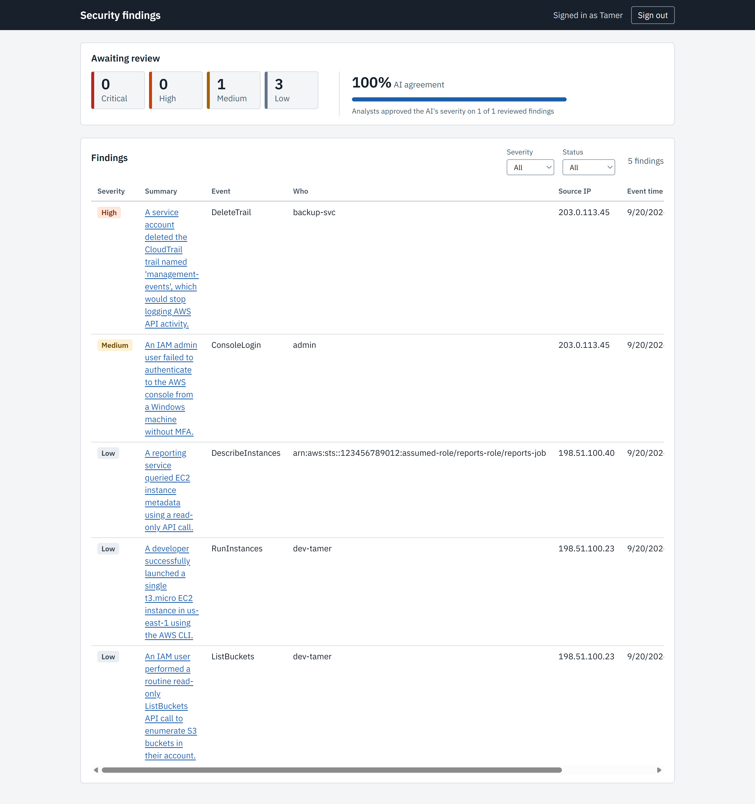

# ai-security-triage


AI-assisted triage of AWS security logs. The service takes in CloudTrail events, cleans them into one standard format, and uses a large language model (LLM) to suggest how serious each one is and why. A person reviews every suggestion before anything is acted on, and records whether the AI got it right.



## Status

**In progress.** Next: deploying to AWS with Terraform (started: remote state in S3 and a monthly budget alert).

- [x] Sample CloudTrail data
- [x] TypeScript project setup
- [x] Log intake and cleanup
- [x] Storage in Postgres
- [x] AI triage step, with accuracy tests (evals)
- [x] Findings API, with sign-in tokens
- [x] Analyst screen
- [x] Tests on every push (GitHub Actions)
- [x] Build the analyst screen in CI
- [x] Cost, time and failure rate per alert + Python tests
- [x] Evals: count ratings that were too low vs too high
- [x] Evals: separate cases for related activity, with labels that account for it
- [x] Security dashboard design for the analyst screen
- [ ] Infrastructure in Terraform (live on AWS)
- [ ] Stretch: let the AI choose its own lookups (tool calling), compared against the fixed rules in evals

## How it works

1. **Security logs.** Sample AWS CloudTrail events, which record every action taken in an AWS account.
2. **Take in and clean up.** Each event is converted to one standard format, and duplicates are removed.
3. **Store.** Events are saved in a Postgres database.
4. **AI triage.** For each event, the code pulls related activity (same user or same IP address within 24 hours), including what each action was done to, such as which bucket, policy or user. It sends this with the event to Claude. Claude returns a severity (low, medium, high or critical), a summary, its reasoning, the evidence it used, and what it couldn't tell. The result is saved as a finding.
5. **Findings API.** Lists findings with filters, returns one finding with its original event, and records reviews. Every request needs a signed token.
6. **Analyst screen.** A dashboard shows how many findings await review at each severity, and the AI agreement rate: the share of reviewed findings where the analyst approved the AI's severity. A person filters the findings, reads the AI's reasoning and the raw event, and submits a review:
   - **Decision:** was the AI's severity right (approve) or wrong (reject)?
   - **Classification:** what was the activity: a real threat (true positive), real but expected (benign positive), or a wrong finding (false positive)?
   - **Note:** required, explaining the call.

   Keeping the decision separate from the classification gives an ongoing measure of how often the AI's severity is right.

## Accuracy tests (evals)

Two hand-labeled eval sets. `python -m triage.evals` runs the AI on one of them and scores the results. Every logged run is recorded in [`triage/EVAL_LOG.md`](triage/EVAL_LOG.md) with the model and a fingerprint of the prompt, so changes can be traced.

- **`triage/eval_cases.json`:** 16 CloudTrail events, each labeled as a person would judge it on its own.
- **`triage/eval_context_cases.json`:** 8 events with related activity designed for each one, labeled with that activity in mind. They come in pairs: the same kind of event with routine activity around it, and with suspicious activity around it. A pair tests whether the AI actually uses the context. Run with `--context-set`.

Latest results (claude-haiku-4-5, October 2026):

| Setup                                      | Exact match | Within one level | Rated too low | Rated too high | Failed | Cost per 1,000 alerts | Avg time per alert |
| ------------------------------------------ | ----------- | ---------------- | ------------- | -------------- | ------ | --------------------- | ------------------ |
| Event only (16 cases)                      | 12/16 (75%) | 15/16 (94%)      | 2             | 2              | 0      | $2.63                 | 4.1s               |
| Context cases, designed activity (8 cases) | 7/8 (88%)   | 8/8 (100%)       | 0             | 1              | 0      | $2.97                 | 4.5s               |

**Rated too low** is the costly mistake in security: a real problem would sit lower in the queue than it should. **Rated too high** creates extra work but misses nothing.

On the context cases, the AI rated every routine/suspicious pair differently, in the right direction: it lowered routine activity, such as hourly CI deployments and test-bucket cleanup, and raised suspicious activity, such as self-granted admin rights after a login, password spraying, and bulk reads followed by stopping CloudTrail. The one miss was a single failed login, labeled low and rated medium.

Running the 16 event-only cases with related activity drawn from each other scores much lower (5/16 exact, all misses rated too high). That set wasn't built for it: 7 of the 16 cases share one IP address and user within 24 hours, so routine events appear next to unrelated risky ones and the AI reasonably raises them. The context cases replace that comparison.

Cost comes from the token counts Claude reports for each call, at Claude Haiku 4.5's published prices. Scores vary from run to run by about one case. With sets this small, one case changes the score by 6 points (16 cases) or 13 points (8 cases).

## Tech

- **TypeScript and Node.js** for log intake and the Findings API (Fastify)
- **Python** for the AI triage step and its evals
- **Claude** (Anthropic API) with structured output, checked against a schema
- **PostgreSQL** for storage, run locally with Docker Compose
- **React and Vite** for the analyst screen
- **JWT** (jose) for API sign-in tokens
- **Vitest** for TypeScript tests, including database tests against a separate test database
- **GitHub Actions** to run the tests on every push
- **Terraform** for AWS infrastructure (in progress: remote state in S3 and a budget alert); hosting on AWS (Lambda, SQS, S3) is planned

## Project layout

```
samples/         Sample CloudTrail events used for development and tests
src/ingest/      Log intake and cleanup
src/db/          Database connection and queries
src/api/         Findings API
src/auth/        Sign-in tokens
db/migrations/   Database tables, applied in number order
triage/          AI triage step, evals and eval log (Python)
web/             Analyst screen (React)
tests/           TypeScript tests (tests/integration/ needs the database)
infra/           Terraform files (in progress)
```

## Running it locally

Requires Node.js 24, Python 3.13, and Docker.

**1. Settings.** Copy `.env.example` to `.env` and fill in the values. Create `JWT_SECRET` with:

```bash
node -e "console.log(require('crypto').randomBytes(32).toString('hex'))"
```

**2. Database.** Start Postgres (on port 5433) and create the tables:

```powershell
docker compose up -d
Get-ChildItem db/migrations/*.sql | ForEach-Object { Get-Content $_ | docker compose exec -T db psql -U triage -d triage -v ON_ERROR_STOP=1 }
```

On macOS or Linux, the second line is:

```bash
for f in db/migrations/*.sql; do docker compose exec -T db psql -U triage -d triage -v ON_ERROR_STOP=1 < "$f"; done
```

**3. Load events and run the triage.**

```bash
npm install
npm run ingest
python -m venv .venv          # then activate it
pip install -r requirements.txt
python -m triage.run --limit 10
```

**4. Start the API and the analyst screen** (in two terminals):

```bash
npm run api
```

```bash
cd web
npm install
npm run dev
```

Open http://localhost:5173. To sign in, create a token and paste it in:

```bash
npm run token -- analyst-1 "Your Name"
```

**Tests**

```bash
npm test                # unit tests
npm run test:db:pg      # database tests against local Postgres (needs Docker running)
npm run test:data-api   # the same tests against Aurora (needs aws sso login)
python -m triage.evals
```

## About the sample data

The events in `samples/` are made up for development. The IP addresses (198.51.100.x and 203.0.113.x) and the AWS account number (123456789012) are reserved for documentation, so they don't point to any real person or account.

## License

MIT
