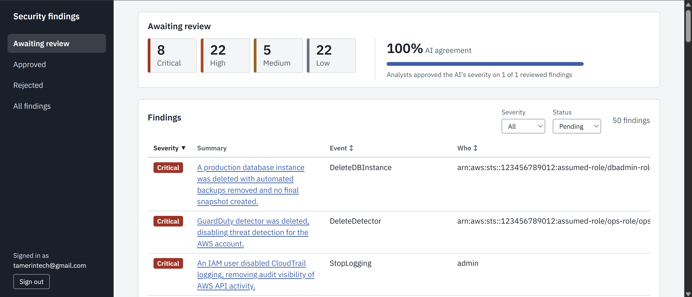
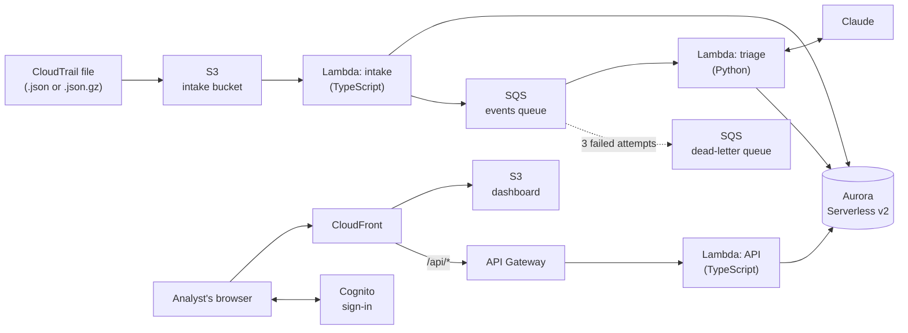

# ai-security-triage


AI-assisted triage of AWS security logs. The service takes in CloudTrail events, cleans them into one standard format, and uses a large language model (LLM) to suggest how serious each one is and why. A person reviews every suggestion before anything is acted on, and records whether the AI got it right.

It runs on AWS, built entirely with Terraform and deployed from GitHub Actions on every push to `main`.

## Live demo

**[d27ph3vqvw136n.cloudfront.net](https://d27ph3vqvw136n.cloudfront.net)**

Demo login: `demo@example.com` / `demo-hire-Tamer-pronto-2026`

The demo account can view everything but cannot review findings; the API enforces that, not just the screen.

The database scales to zero when nobody is using it. If the demo has been idle for a while, the first request wakes it up, which can take 15 to 30 seconds and occasionally longer than the API's 30-second limit. If the first page shows an error, reload it.



## How it works



1. **Take in.** A CloudTrail file uploaded to S3 starts the intake function. It converts each event to one standard format, removes duplicates, saves the events, and queues each one for triage.
2. **AI triage.** The triage function pulls related activity for each event (same user or same IP address within 24 hours), including what each action was done to, such as which bucket, policy or user. It sends this with the event to Claude, which returns a severity (low, medium, high or critical), a summary, its reasoning, the evidence it used, and what it couldn't tell. The result is saved as a finding.
3. **Review.** Analysts sign in through Cognito. The dashboard shows how many findings await review at each severity, and the AI agreement rate: the share of reviewed findings where the analyst approved the AI's severity. An analyst reads the AI's reasoning and the raw event, then records:
   - **Decision:** was the AI's severity right (approve) or wrong (reject)?
   - **Classification:** what was the activity: a real threat (true positive), real but expected (benign positive), or a wrong finding (false positive)?
   - **Note:** required, explaining the call.

   Keeping the decision separate from the classification gives an ongoing measure of how often the AI's severity is right.

## Design decisions

**A database that costs almost nothing when idle.** Aurora Serverless v2 pauses after 5 idle minutes and charges only for storage while paused. The trade-off is the wake-up delay on the first request. An always-on database would cost about $17 a month whether anyone used it or not.

**No open database port.** The code talks to Aurora through the RDS Data API: HTTPS requests authorized by IAM, with the database password held in Secrets Manager. Nothing can connect to the database directly, and no function needs to run inside the private network, so there is no NAT gateway to pay for. A small interface lets the same code use a normal Postgres connection locally and the Data API on AWS, and the database tests run against both.

**Safe to process twice.** SQS delivers each message at least once, so a message can arrive twice. Saving an event does nothing if it is already stored, triage skips events that already have a finding (no second Claude call), and a unique index guarantees one finding per event even if two copies race.

**Failures are kept, not lost.** A message that fails triage three times moves to a dead-letter queue, where it can be inspected and sent back once the cause is fixed. A file the intake function cannot process lands in its own failure queue instead of being dropped.

**Capped spend.** At most two copies of the triage function run at once, so a large upload queues up instead of calling Claude in parallel. The API is limited to 10 requests a second. A monthly AWS budget sends an alert at $10 spent and at a forecast of $20.

**No AWS keys in GitHub.** The deploy job proves its identity to AWS with a short-lived GitHub token (OIDC). The deploy role trusts only this repository's `main` branch, identified by its permanent numeric ID, and can only update code: upload Lambda functions and the dashboard, refresh the CDN, and run database migrations. It cannot create, change or delete infrastructure; that stays with Terraform.

**Least-privilege functions.** Each function has its own role, scoped to the specific queue, bucket, parameter and database it uses. The Anthropic API key is stored as an encrypted parameter that Terraform writes but never keeps in its state file.

**Sign-in.** Cognito handles accounts and passwords, so the code never sees a password. The dashboard uses the authorization code flow with PKCE, and the API checks each token's signature, issuer, audience and expiry against Cognito's published keys. Only members of the `reviewers` group can record reviews.

## Accuracy tests (evals)

Two hand-labeled eval sets. `python -m triage.evals` runs the AI on one of them and scores the results. Every logged run is recorded in [`triage/EVAL_LOG.md`](triage/EVAL_LOG.md) with the model and a fingerprint of the prompt, so changes can be traced.

- **`triage/eval_cases.json`:** 16 CloudTrail events, each labeled as a person would judge it on its own.
- **`triage/eval_context_cases.json`:** 8 events with related activity designed for each one, labeled with that activity in mind. They come in pairs: the same kind of event with routine activity around it, and with suspicious activity around it. A pair tests whether the AI actually uses the context. Run with `--context-set`.

Latest results (claude-haiku-4-5, October 2026):

| Setup                                      | Exact match | Within one level | Rated too low | Rated too high | Failed | Cost per 1,000 alerts | Avg time per alert |
| ------------------------------------------ | ----------- | ---------------- | ------------- | -------------- | ------ | --------------------- | ------------------ |
| Event only (16 cases)                      | 12/16 (75%) | 15/16 (94%)      | 2             | 2              | 0      | $2.63                 | 4.1s               |
| Context cases, designed activity (8 cases) | 7/8 (88%)   | 8/8 (100%)       | 0             | 1              | 0      | $2.97                 | 4.5s               |

**Rated too low** is the costly mistake in security: a real problem would sit lower in the queue than it should. **Rated too high** creates extra work but misses nothing.

On the context cases, the AI rated every routine/suspicious pair differently, in the right direction: it lowered routine activity, such as hourly CI deployments and test-bucket cleanup, and raised suspicious activity, such as self-granted admin rights after a login, password spraying, and bulk reads followed by stopping CloudTrail. The one miss was a single failed login, labeled low and rated medium.

Running the 16 event-only cases with related activity drawn from each other scores much lower (5/16 exact, all misses rated too high). That set wasn't built for it: 7 of the 16 cases share one IP address and user within 24 hours, so routine events appear next to unrelated risky ones and the AI reasonably raises them. The context cases replace that comparison.

Cost comes from the token counts Claude reports for each call, at Claude Haiku 4.5's published prices. Scores vary from run to run by about one case. With sets this small, one case changes the score by 6 points (16 cases) or 13 points (8 cases).

## Running cost

Measured with AWS Cost Explorer, early November 2026:

| What                   | Cost                      |
| ---------------------- | ------------------------- |
| AWS, idle or light use | about $1 a month          |
| AI triage (Claude)     | about $3 per 1,000 events |

Nearly all of the AWS cost is the database's storage and the Secrets Manager secret that holds its password (about $0.40 a month). Lambda, SQS, API Gateway, CloudFront and S3 together cost fractions of a cent at this volume.

## Tech

- **TypeScript and Node.js** for log intake and the findings API (Fastify)
- **Python** for the AI triage step and its evals
- **Claude** (Anthropic API) with structured output, checked against a schema
- **PostgreSQL**: Docker Compose locally; Aurora Serverless v2 on AWS, reached through the RDS Data API
- **React and Vite** for the analyst dashboard
- **AWS**: Lambda, SQS, S3, API Gateway, CloudFront, Cognito, Systems Manager Parameter Store, Secrets Manager, IAM
- **Terraform** for all AWS infrastructure, with remote state in S3
- **GitHub Actions** to test every push and deploy `main`, signing in to AWS with OIDC
- **Vitest** and **pytest** for tests, including database tests run against both local Postgres and Aurora

## Status

- [x] Log intake and cleanup
- [x] AI triage step, with evals for accuracy, too-low vs too-high misses, cost and time
- [x] Evals for related activity, with labels that account for it
- [x] Findings API and analyst dashboard
- [x] Tests on every push (GitHub Actions)
- [x] Infrastructure in Terraform, live on AWS
- [x] Automatic intake and triage on AWS (S3, SQS, Lambda)
- [x] Cognito sign-in, with a view-only demo account
- [x] Deploys from CI after all tests pass
- [ ] Stretch: let the AI choose its own lookups (tool calling), compared against the fixed rules in evals

## Project layout

```
samples/         Sample CloudTrail events used for development and tests
src/ingest/      Log intake and cleanup, and the intake Lambda
src/db/          Database access: node-postgres locally, the Data API on AWS
src/api/         Findings API, run locally or as a Lambda
src/auth/        Sign-in: local development tokens and Cognito
db/migrations/   Database tables, applied in number order
triage/          AI triage step, its Lambda, evals and eval log (Python)
web/             Analyst dashboard (React)
tests/           TypeScript tests (tests/integration/ needs a database)
infra/           Terraform for everything on AWS
scripts/         Lambda builds and test-data generation
```

## Running it locally

Requires Node.js 24, Python 3.13, and Docker. Local development needs no AWS account: it uses Postgres in Docker and signs in with locally made tokens.

**1. Settings.** Copy `.env.example` to `.env` and fill in the values. Create `JWT_SECRET` with:

```bash
node -e "console.log(require('crypto').randomBytes(32).toString('hex'))"
```

**2. Database.** Start Postgres (on port 5433) and create the tables:

```powershell
docker compose up -d
Get-ChildItem db/migrations/*.sql | ForEach-Object { Get-Content $_ | docker compose exec -T db psql -U triage -d triage -v ON_ERROR_STOP=1 }
```

On macOS or Linux, the second line is:

```bash
for f in db/migrations/*.sql; do docker compose exec -T db psql -U triage -d triage -v ON_ERROR_STOP=1 < "$f"; done
```

**3. Load events and run the triage.**

```bash
npm install
npm run ingest -- samples/cloudtrail_sample.json
python -m venv .venv          # then activate it
pip install -r requirements.txt
python -m triage.run --limit 10
```

**4. Start the API and the dashboard** (in two terminals):

```bash
npm run api
```

```bash
cd web
npm install
npm run dev
```

Open http://localhost:5173. To sign in, create a token and paste it in:

```bash
npm run token -- analyst-1 "Your Name"
```

**Tests**

```bash
npm test                    # unit tests
npm run test:db:pg          # database tests against local Postgres (needs Docker running)
npm run test:db:data-api    # the same tests against Aurora (needs aws sso login)
python -m pytest triage     # Python tests
python -m triage.evals      # evals (calls Claude)
```

## Deploying

Infrastructure is managed with Terraform from `infra/` (`terraform plan`, then `terraform apply`). Application code deploys itself: every push to `main` runs the tests, then the `deploy` job in [`.github/workflows/ci.yml`](.github/workflows/ci.yml) runs database migrations, uploads the three Lambda functions, and uploads the dashboard.

To run a CloudTrail file through the live pipeline, upload it to the intake bucket. `npm run sample:fresh` makes a copy of the sample file with new event IDs and current times, gzipped like a real CloudTrail file.

## About the sample data

The events in `samples/` are made up for development. The IP addresses (198.51.100.x and 203.0.113.x) and the AWS account number (123456789012) are reserved for documentation, so they don't point to any real person or account.

## License

MIT
